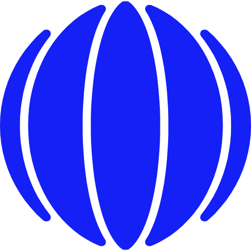
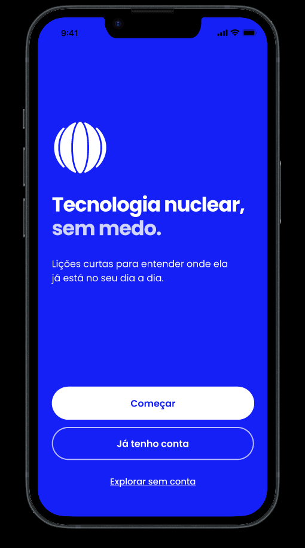
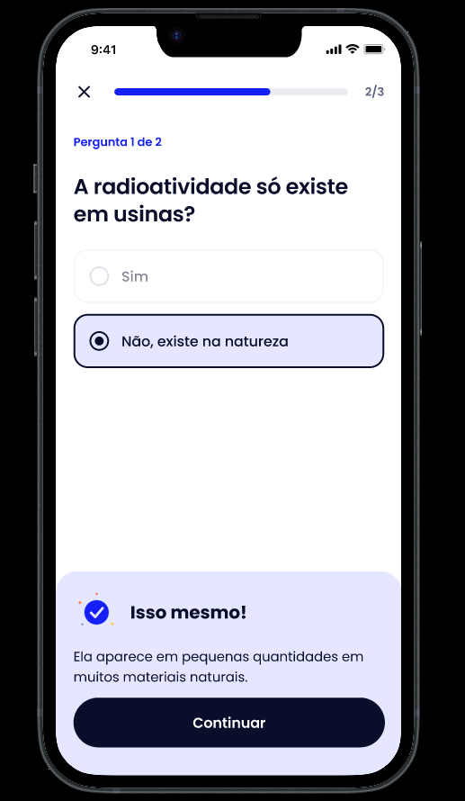
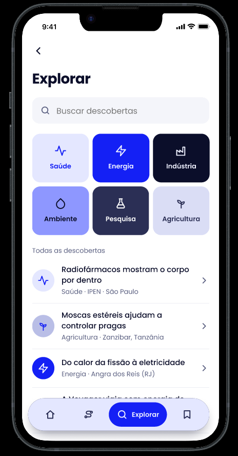
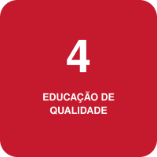
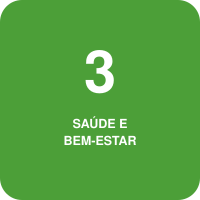
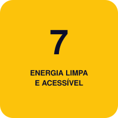
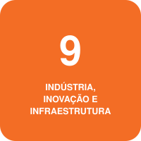
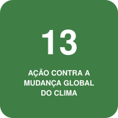

<div align="center">

<picture>
  <source media="(prefers-color-scheme: dark)" srcset="docs/imagens/logo-branco.png">
  
</picture>

# LUMAR
**Tecnologia nuclear, sem medo.**

Um aplicativo para descobrir, em lições curtas e sem complicação, onde a tecnologia nuclear já está no nosso dia a dia.

<sub>Protótipo de front-end · Challenge FIAP × AMAZUL</sub>

</div>

---

## Links úteis

| 🎬 Vídeo pitch | 🎨 Protótipo no Figma | 📘 Brandbook | 💻 Repositório |
|:---:|:---:|:---:|:---:|
| [Assistir](https://youtu.be/qaURvhUunm0) | [Abrir](https://www.figma.com/design/ZzPO6KsEZu40kNiQM5cpSG/Challenge-Amazul?node-id=0-1&t=eTO5oxkZP4yHkkR8-1) | [Baixar PDF](docs/brandbook/marca.pdf) | [GitHub](https://github.com/CHALLENGE-AMAZUL/fe-atomic-learning) |

---

## Por que isso existe

Pergunte a alguém o que vem à cabeça quando ouve "nuclear". Quase sempre a resposta é usina, radiação, bomba. Pouca gente lembra que a mesma tecnologia aparece no exame que mostra o corpo por dentro, na conservação de alimentos, na pesquisa e na geração de energia.

Esse desencontro cria medo e desinformação sobre algo que, bem explicado, faz parte da vida de todo mundo.

## A nossa ideia

Criamos uma plataforma de **descobertas**: histórias curtas, em linguagem do dia a dia, que ligam um tema a um lugar ou a uma situação real. A pessoa não precisa saber nada sobre o assunto para começar, e também não precisa criar conta para ver como funciona.

A ideia é partir do que já conhecemos e mostrar o que ainda não enxergamos. Em vez de despejar conceitos, cada descoberta responde a uma pergunta simples: *onde isso aparece na minha vida e por que importa?*

### Como é uma descoberta

Todas seguem o mesmo roteiro, para que ler uma ajude a entender a próxima:

1. **O problema**: o que as pessoas enfrentavam ou perguntavam.
2. **A aplicação nuclear**: o que a tecnologia faz, explicado com palavras e imagens simples.
3. **O benefício**: o que muda na prática.
4. **Os limites**: o que ela não resolve e quais cuidados existem.

No fim, sempre aparece a **fonte**, para quem quiser conferir ou se aprofundar.

Alguns exemplos do tipo de história que o app conta: *como o calor de uma usina vira a eletricidade da casa de alguém*, *como um exame de imagem usa substâncias radioativas em quantidades planejadas*, *como uma técnica com insetos ajuda a reduzir pragas* e *como sondas no espaço geram energia longe do Sol*.

### Seis temas para começar

**Saúde · Energia · Indústria · Ambiente · Pesquisa · Agricultura.** A pessoa escolhe os que despertam sua curiosidade e o app organiza as descobertas a partir daí.

### Conteúdo com cuidado

Falar de tecnologia nuclear exige responsabilidade. Por isso o desenho da plataforma prevê que cada história seja revisada por pessoas antes de ser publicada, que traga sua fonte e que fale de riscos ao lado dos benefícios. O app nunca dá orientação médica: ele explica, não receita.

### Para quem

Pensamos primeiro em jovens adultos curiosos, sem formação na área. É uma hipótese que ainda queremos validar com pessoas de verdade, e não um resultado que já tenhamos medido.

## Como é usar

<table>
<tr>
<td width="58%" valign="middle">

### Tela de Boas Vindas

A primeira tela já diz a motivação do aplicativo: *tecnologia nuclear, sem medo*. Dá para criar uma conta em poucos passos, contando ao app o que você quer aprender primeiro, ou simplesmente explorar sem conta e ver como funciona.

</td>
<td width="42%" align="center">



</td>
</tr>
<tr>
<td width="42%" align="center">



</td>
<td width="58%" valign="middle">

### Aprende em lições curtas

Cada lição traz uma ideia, uma pergunta e um retorno que acolhe. Errou? O app explica o porquê, sem punir. Acertou? Comemora com você e segue para a próxima.

</td>
</tr>
<tr>
<td width="58%" valign="middle">

### Descobre onde a tecnologia está

Em *Explorar*, cada tema vira uma descoberta: qual era o problema, como a tecnologia nuclear ajuda e o que ela traz de benefício. Dá para salvar o que gostou e, se faltar algum assunto, **sugerir um tema novo** para o time.

</td>
<td width="42%" align="center">



</td>
</tr>
</table>

> Esta é a versão de **protótipo**: serve para mostrar a experiência e o jeito de falar do app. O conteúdo das telas é de exemplo. As demais telas estão no Figma, logo abaixo.

## Acessibilidade

Um app que quer falar com todo mundo precisa ser fácil de usar por todo mundo. No protótipo, já pensamos em:

- **Textos legíveis**, com bom contraste entre letra e fundo.
- **Fonte que cresce**: o app respeita o aumento de texto configurado no celular.
- **Informação que não depende só de cor**: acerto e erro vêm sempre com uma palavra ou um ícone.
- **Botões fáceis de tocar** e com nomes claros para leitores de tela.
- **Telas de apoio** para quando algo está vazio ou dá errado, sempre dizendo o que fazer em seguida.
- **Sem barreiras para começar**: dá para explorar sem criar conta.

## Objetivos de Desenvolvimento Sustentável

A educação é o centro do projeto, e as histórias tocam em outros objetivos conforme o tema de cada uma.

<p align="center">
  
  
  
  
  
</p>

A **ODS 4** é o eixo do app: ensinar de forma acessível. Já as ODS **3** (saúde), **7** (energia), **9** (indústria e inovação) e **13** (clima) aparecem quando a descoberta fala desses assuntos. Explicar um tema não resolve o problema por si só, e o app não mede impacto nesses objetivos. Ele ajuda a entender o que existe.

## O que vem depois

Transformar essas telas em um aplicativo de verdade, ligá-lo a um catálogo de conteúdo revisado e testar com quem vai usar. A plataforma foi pensada para crescer, e esta entrega mostra a primeira etapa.

---

## Vídeo pitch

> ▶️ **[Assista ao pitch do projeto](https://youtu.be/qaURvhUunm0)**

## Design

- 🎨 **[Telas e protótipo no Figma](https://www.figma.com/design/ZzPO6KsEZu40kNiQM5cpSG/Challenge-Amazul?node-id=0-1&t=eTO5oxkZP4yHkkR8-1)**
- 📘 **[Brandbook (PDF)](docs/brandbook/marca.pdf)**: identidade visual, cores, tipografia e tom de voz.

## Equipe

| Integrante | RM | Frentes principais |
|---|---|---|
| Renan da Silva Paulino | RM566610 | Design, Front-end, IoT e Java |
| Sérgio Henrique S. | RM567254 | DevOps, Compliance & QA e Java |
| Paulo Cavalcante Caroba | RM566667 | Java, DB Oracle e .NET |

Todos participam e entendem a solução. As frentes indicam quem lidera cada parte, e não quem a faz sozinho.

_Turma 2TDS · FIAP_

## Parceiro

Projeto do **Challenge FIAP**, com tema apresentado pela **AMAZUL**, empresa ligada à Marinha do Brasil.

É um trabalho acadêmico. O nome e a identidade visuais ainda são do nosso time e não representam posicionamento oficial da AMAZUL ou da Marinha.

## Como executar

A entrega desta Sprint é um **protótipo em Figma**. Por isso não há nada para instalar:

1. Abra o [protótipo no Figma](https://www.figma.com/design/ZzPO6KsEZu40kNiQM5cpSG/Challenge-Amazul?node-id=0-1&t=eTO5oxkZP4yHkkR8-1).
2. Clique em **Apresentar** (▶) no canto superior direito para navegar pelas telas como no celular.
3. Lá dentro tem acesso a nossa logo em diferentes cores e tamanhos, além de componentes já identificados e separados para construção do app futuramente em flutter.

Para ter o material em casa, clone o repositório:

```bash
git clone https://github.com/CHALLENGE-AMAZUL/fe-atomic-learning.git
```

## Entrega

O projeto é entregue pelo **Teams**, em um arquivo `.zip` com o conteúdo deste repositório.

🔗 **Repositório no GitHub:** [https://github.com/CHALLENGE-AMAZUL/fe-atomic-learning](https://github.com/CHALLENGE-AMAZUL/fe-atomic-learning)

## Tecnologias

- **Figma**: desenho das telas e do fluxo
- **Git e GitHub**: versionamento e trabalho em equipe

---

<div align="center"><sub>Feito por quem acredita que entender ajuda a perder o medo.</sub></div>
